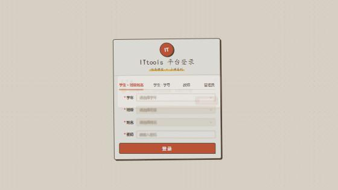
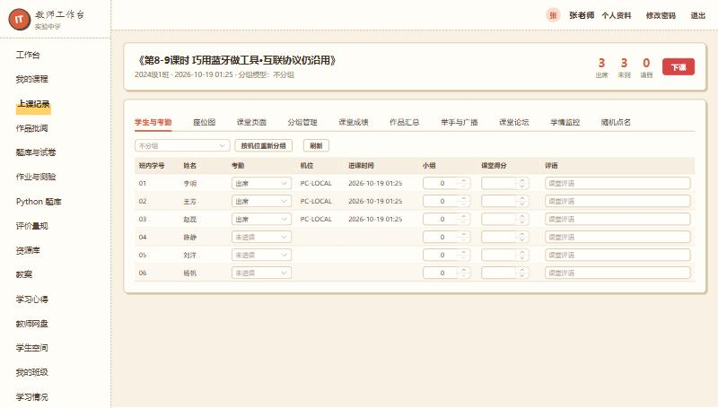

# ITtools · 中小学信息技术教学平台

> 面向中小学信息技术课的「备课 + 上课 + 自动评分 + 机房管理」一体化平台。
> 一台服务器、一个 jar、一个 PostgreSQL，局域网内的教师机和学生机用浏览器即可使用。


<p align="center">
  
  
</p>

---

## 直接下载使用

不需要编译源码：到 [**Releases**](https://github.com/tuyaosheng/ITtools-/releases/latest) 下载最新的 `ITtools.zip`，
解压后按里面的 `部署说明.txt` 操作即可（装好 Java 8+ 和 PostgreSQL 14+，改好 `start.bat` 里的数据库密码，双击启动）。

| 文件 | 用途 |
| --- | --- |
| `ITtools.zip` | 完整交付包：程序、启动脚本、防火墙脚本、备份脚本、使用说明书（Word）、学生机脚本与掌控板助手 |
| `ittools.jar` | 只有程序本身，已部署过的学校升级时用：关掉 `start.bat` 窗口，覆盖 `ittools.jar`，再启动 |

升级前先备份数据库和 `data/storage`，数据库结构会在启动时自动升级。

---

## 目录

- [直接下载使用](#直接下载使用)
- [项目背景](#项目背景)
- [功能一览](#功能一览)
  - [管理员端](#管理员端)
  - [教师端](#教师端)
  - [学生端](#学生端)
  - [课程页面类型](#课程页面类型)
  - [自动评分](#自动评分)
  - [掌控板 / 物联网教学](#掌控板--物联网教学)
- [技术栈](#技术栈)
- [系统架构](#系统架构)
- [目录结构](#目录结构)
- [快速开始（开发环境）](#快速开始开发环境)
- [构建与打包](#构建与打包)
- [部署](#部署)
  - [方式一：Windows 服务器直接运行（推荐）](#方式一windows-服务器直接运行推荐)
  - [方式二：Docker Compose](#方式二docker-compose)
  - [学生机准备](#学生机准备)
- [配置项](#配置项)
- [数据库与迁移](#数据库与迁移)
- [测试](#测试)
- [备份与升级](#备份与升级)
- [安全设计](#安全设计)
- [常见问题](#常见问题)
- [已知限制](#已知限制)
- [文档索引](#文档索引)
- [第三方组件与许可](#第三方组件与许可)

---

## 项目背景

ITtools 3.51 是一套在不少中小学机房里用了多年的信息技术教学平台，原系统基于
**Windows Server 2003 + ASP.NET WebForms (VB) + SQL Server 2005**，核心逻辑封装在无源码的 DLL 里，
依赖 Flash、FrontPage 等早已淘汰的技术，已无法在现代系统和浏览器上维护。

本项目是对它的**彻底重写**，目标是：

| 原则 | 说明 |
| --- | --- |
| 功能等价 | 原系统的主要功能一个不少：三种角色、课堂流程、作品提交与批阅、测验、机房座位与开断网、学情统计…… |
| 界面重设计 | 不照搬 WebForms 界面，改用 Vue 3 单页应用，「手账温暖」风格，教师端和管理端适配手机 |
| 评分重设计 | 自动评分规则从零设计（Office 文档细粒度检查、Python 测试点、Mind+ 积木检查），不逆向旧引擎 |
| 砍掉死技术 | 不再支持 Flash / FrontPage / FlashPaper / Access / Photoshop / VB 等操作题 |
| 部署简单 | 单校、单租户、局域网；一个 fat jar + PostgreSQL，Windows 上双击 `start.bat` 即可运行 |
| 全新建库 | 不迁移旧系统历史数据，数据库结构由 Flyway 自动创建与升级 |

在此基础上还加入了原系统没有的新能力：Python 在线编程与自动评测、图形化编程直连掌控板、
内置 MQTT 服务器做物联网课、成绩达标自动开网、小组配对任务等。

---

## 功能一览

平台分 **管理员 / 教师 / 学生** 三种角色，共用一张用户表，登录后进入各自的后台。
教师可被设为「兼任管理员」，用同一个账号进入管理后台。

### 管理员端

| 模块 | 功能 |
| --- | --- |
| 年级 / 班级 | 学年（入学年份）管理、启用停用；班级增删改、排序 |
| 用户管理 | 分页搜索（按角色、学年、班级、姓名 / 学号 / 登录名）；重置密码、启用 / 毕业开关；教师「兼任管理员」开关 |
| 批量导入 | Excel / CSV 导入学生、教师，后台任务 + 进度条，逐行列出失败原因；不存在的年级、班级自动创建 |
| 学生数据维护 | 下载学生表批量修改（预览后确认写入）、批量导入头像（zip）、整班毕业 / 恢复、释放毕业生资源空间 |
| 机房管理 | 机位（计算机名 + IP）登记与导入；机房座位图（按方案自动排版或逐格调整）；分组模型；班级固定座位 |
| 网络控制 | 对接网络控制器（CTR），座位图上批量开网 / 断网；每个机房可设独立控制器 |
| 教学管理 | 学期维护与当前学期；班级绑定任课教师；查看当前所有课堂、强制下课 |
| 走班选课 | 建选课活动和科目（人数上限、教师、时间），开放 / 结束选课，导出名单 |
| 系统设置 | 学校名称、工作模式（正常教学 / 公开课 / 学号登录 / 固定机位）、上传限制与网盘容量、学生单处登录策略、补交、敏感词、登录页公告、第三方程序免密登录（HMAC 签名）、内置 MQTT 服务器、网络控制器 |
| 功能开关 | 按学生 / 教师分别开关菜单功能（对应接口同时被拦截） |
| 应急工具 | 全部强制下课、消除缺勤记录、学期修复、强制删除已开课课程 |

### 教师端

| 模块 | 功能 |
| --- | --- |
| 工作台 / 课表 | 当前学期、进行中的课堂、最近上课记录、今日课表；一键开课 |
| 我的课程 | 课程 + 页面式备课（20 种页面类型），默认隐藏页、按小组角色可见；复制、归档、共享为模板；**课程包**导出导入（含页面设置和 `media/` 视频） |
| 课堂控制台 | 考勤与课堂评分、座位图、逐页开关、分组管理（自由选组 / 随机 / 按学号 / 小组角色与配对）、课堂成绩、作品汇总、举手与广播、课堂论坛、学情监控（页面停留时长）、随机点名、物联网消息大屏、**成绩开网** |
| 上课记录 | 回看已结束课堂、撤销、重新开课（保留提交、成绩、分组） |
| 作品批阅 | 逐份打分写评语、采用自动分、发回重做、设精华；批量统一打分、打包下载、循环展播、按新规则重评；评价量规 |
| 题库与测验 | 单选 / 多选 / 判断 / 填空；星级、标签、分类、共享、回收站、查重合并；Excel / 题库包 / 截图批量入库；试卷手动组卷或随机抽题；控制模式 / 自动模式 / 提交即批改三种考试方式；限时、乱序、公布答案时机；成绩分析与年级统计 |
| 刷题 | 给班级指定刷题题库，查看刷题情况和错误率报表 |
| Python 题库 | 题干、半成品代码、参考代码、测试点；参考代码一键生成期望输出；开放为课后题 |
| 班级与学情 | 我的班级（在线状态、强制下线、学生课堂记录）、期末统计（加权总评、名次、导出 Excel）、登入记录、学生空间（网盘、个人网站、指法榜）、学习心得点评 |
| 沟通 | 系统消息群发 / 撤回 / 阅读情况；师生答疑，可公开为「公开问答」 |
| 资料 | 资源库（分发给班级、阅读时长统计）、教案（附课件、打包导入导出）、教师网盘 |

### 学生端

| 模块 | 功能 |
| --- | --- |
| 我的课堂 | 进入课堂即签到，显示机位和小组；只看到老师已开放的页面；举手求助、「谢谢 TA」互助榜、课堂论坛 |
| 完成情况 | 开了成绩开网时，实时显示自己 / 本组 / 搭档组还差什么 |
| 作品与成绩 | 我的作品（自动分、教师评分评语、补交 / 重做提醒）、精华作品展与排行榜、学习记录、我的学情 |
| 作业与练习 | 课后作业与测验、错题本、刷题练习、Python 练习、课后操作题（自动评分、可反复练） |
| 学习工具 | 学习资源（记录阅读时间）、个人网盘、个人网站（上传 zip 发布）、指法练习与英雄榜、学习笔记、图形化编程（随时练习） |
| 其他 | 走班选课、系统消息、师生答疑、个人资料与头像 |

### 课程页面类型

| 类型 | 用途 |
| --- | --- |
| 图文 / 资料课件 / 视频 / 外部网页 | 基本学习内容 |
| 作品提交 | 上传作品，可自动评分、同学互看互评；可开启内嵌「图形化编程」并旁挂任务单 |
| 课堂测验 | 关联试卷在线作答、自动批改 |
| 讨论 / 抢答 | 小组讨论提交结论；教师发起抢答并判定 |
| Python 操作题 | 浏览器内编写运行（Brython），服务端按测试点评分 |
| 分组与组长 / 小组合作 / 小组成果展示 | 自由选组、组内分工、组员互评、成果展示与组间互评 |
| 课堂调查 / 随机抽题 | 实时统计的调查（可作任务单）；相邻座号题目不同的随机抽题 |
| 课件包 / Scratch 作品 | 播放 Storyline 等 HTML5 课件包、运行 sb / sb2 / sb3 |
| 掌控板编程 | 积木闯关刷进掌控板，教师看板实时看每组进度 |
| 物联网消息 | 展示设备发到内置 MQTT 服务器的消息 |

页面正文支持占位符，上课时按本节课和学生所在小组替换：
`{{MQTT项目}}`、`{{服务器IP}}`、`{{媒体:文件名}}`、`{{组名}}`、`{{组号}}`、`{{角色}}`、`{{配对号}}`。

### 自动评分

| 作品类型 | 评分点 |
| --- | --- |
| Word (.docx) | 段落格式（按样式继承解析）、字体字号、页面设置、页眉页脚、分栏、表格等 |
| Excel (.xlsx) | 单元格格式、合并、边框、排序、筛选、图表类型、条件格式等 |
| PowerPoint (.pptx) | 文字格式、版式、背景、切换效果、超链接等 |
| 网页 | 文件 / 标签 / 内容检查 |
| Mind+ 程序 (.mp / .mpcode) | 使用了某积木、积木嵌套关系、比较积木数值、填写了数值或文字、MQTT 设置（平台 / 服务器 / 主题，主题可用占位符） |
| Python | 测试点（输入 + 期望输出），浏览器自测 + 服务端评测 |

评分点可以用「标准答案」文件一键检验，全部通过才能保存；作品页有评分点通过率报表。

### 掌控板 / 物联网教学

- **图形化编程编辑器**：积木外形、分类、参数与 Mind+ 2.0.7 上传模式的「掌控板 / Wi-Fi / MQTT」一致（126 个积木），程序自动保存到平台，可另存为 Mind+ 能打开的 `.mpcode`。
- **两种上传方式**：
  - *Mind+ 方式*：生成与 Mind+ 相同的 C++，由学生机上的「ITtools 掌控板助手」调用本机 Mind+ 自带的 arduino-cli 编译烧录；
  - *MicroPython 方式*：浏览器通过 Web Serial 直接写入（需先刷 MicroPython 固件，编辑器内可刷）。
- **内置 MQTT 服务器**（Netty 实现，兼容 SIoT 默认配置 1883 / `siot` / `dfrobot`）：每节课自动生成项目名，消息按课堂隔离保存，控制台可投屏大屏、画数值曲线。
- **小组角色与配对**：如「门铃组 / 显示组」两两配对，页面、评分主题、成绩开网都可以按角色和配对号区分。

---

## 技术栈

| 层 | 选型 |
| --- | --- |
| 后端 | Java 8、Spring Boot 2.7.18（Web、Data JPA、Security 5、WebSocket/STOMP、Validation） |
| 数据库 | PostgreSQL（开发 16，学校现场 14 均可）、Flyway 迁移、Hibernate `ddl-auto: validate` |
| 文档处理 | Apache POI 5.2.5（Office 评分、Excel 导入导出）、Commons CSV |
| 物联网 | Netty `codec-mqtt` 内置 MQTT Broker |
| 前端 | Vue 3.5、TypeScript、Vite 5、Element Plus、Pinia、Vue Router、Axios、STOMP.js、CodeMirror 6、DOMPurify |
| 浏览器内运行 | Brython（Web Worker 运行 Python）、TurboWarp Scaffolding（Scratch）、scratch-blocks（图形化编程）、esptool-js（刷固件） |
| 测试 | JUnit 5、Spring Boot Test、Testcontainers（PostgreSQL）、Vitest + Vue Test Utils |
| 学生机工具 | Python 3 标准库 + PyInstaller（掌控板助手） |

> 后端锁定 Java 8 / Spring Boot 2.x（`javax.*`）是为了适配学校服务器现有 JDK；将来换 JDK 17 可升级到 Spring Boot 3。

---

## 系统架构

```
 学生机 / 教师机浏览器 (Chrome / Edge)
        │  HTTP(S) · WebSocket(/ws, STOMP) · SSE
        ▼
 ┌─────────────────────────── ittools.jar (Spring Boot, :8300) ───────────────────────────┐
 │  Vue 3 SPA 静态资源（classpath:/static）  +  REST API (/api/**)                          │
 │                                                                                          │
 │  platform-core   用户/认证/年级班级/导入/设置/功能开关/存储/WebSocket 基础               │
 │  lab-core        机位、机房座位图、分组模型、固定机位、网络控制器(CTR)对接               │
 │  classroom-core  课程/页面/课堂/考勤/课程包/课件包/内置 MQTT                             │
 │  grading-core    自动评分（Office/网页/Mind+）、Python 评测                              │
 │  homework-core   作品提交与批阅、课后作业、课堂成绩、学情报表、图形化编程、掌控板助手接口 │
 │  quiz-core       题库、试卷、测验、刷题、成绩开网                                        │
 │  interact-core   举手/广播/论坛/讨论/抢答/分组/调查/抽题/消息/答疑/掌控板闯关           │
 │  resource-core   资源库、教案、网盘、笔记、个人网站、指法、走班选课                       │
 └──────────────┬───────────────────────┬──────────────────────┬──────────────────────────┘
                │ JDBC                  │ 文件                 │ HTTP
                ▼                       ▼                      ▼
          PostgreSQL              data/storage/          网络控制器 CTR (:8770，可选)
                                  作品/网盘/课件/头像
        掌控板 ──MQTT :1883──▶ 内置 Broker       学生机「掌控板助手」──长轮询──▶ /api/mpagent
```

- **模块化单体**：8 个 Maven 子模块按业务拆分，由 `ittools-app` 汇总打成一个可执行 jar。
- **会话认证**：Spring Security Session + CSRF，三角色统一 `users` 表，密码 BCrypt。
- **实时**：课堂内广播、举手、开关页面等用 WebSocket（STOMP，`/topic`）；掌控板看板用 SSE。
- **存储**：上传文件全部落在 `STORAGE_ROOT`（默认 `data/storage`），数据库只存元数据。

---

## 目录结构

```
.
├── pom.xml                     # Maven 父工程（Spring Boot 2.7.18 / Java 8）
├── ittools-app/                # 启动模块：IttoolsApplication、application.yml、Flyway 迁移、集成测试
│   └── src/main/resources/db/migration/   # V1 ~ V42 数据库迁移脚本
├── modules/
│   ├── platform-core/          # 平台基座
│   ├── lab-core/               # 机房
│   ├── classroom-core/         # 课堂与课程
│   ├── grading-core/           # 评分
│   ├── homework-core/          # 作业与报表
│   ├── quiz-core/              # 测验
│   ├── interact-core/          # 互动
│   └── resource-core/          # 资源
├── web/                        # Vue 3 前端
│   ├── src/
│   │   ├── api/                # axios 封装、STOMP 实时通道
│   │   ├── layouts/            # 管理员 / 教师 / 学生布局
│   │   ├── views/              # 按业务划分的页面
│   │   ├── modules/            # 页面类型、控制台标签注册表
│   │   ├── stores/             # Pinia（登录态、功能开关、通知）
│   │   └── styles/             # 主题变量（手账温暖风）
│   └── public/                 # 原样复用的静态应用
│       ├── mpblocks/           # 图形化编程编辑器
│       ├── mpython/            # 掌控板闯关（mpython-lite）
│       ├── pyrunner/           # Brython Web Worker
│       ├── scratch/            # TurboWarp Scaffolding
│       └── typing/             # 指法练习
├── tools/mpagent/              # 学生机「ITtools 掌控板助手」（Python）
├── scripts/
│   ├── demo/                   # 演示数据生成与演示环境启动脚本
│   ├── mpython/                # 学生机浏览器配置脚本（Web Serial 白名单）
│   └── md2docx.js              # 使用说明书 Markdown → Word
├── docs/                       # 使用说明书、测试手册、测试报告、设计文档、Mind+ 积木清单
├── Dockerfile                  # 三阶段构建：前端 → 后端 → JRE 运行
└── docker-compose.yml          # PostgreSQL 16 + 应用
```

---

## 快速开始（开发环境）

### 环境要求

| 工具 | 版本 |
| --- | --- |
| JDK | 8（项目 `java.version=8`，更高版本 JDK 也能编译运行） |
| Maven | 3.6+ |
| Node.js | 20+（开发使用 Node 24 亦可） |
| PostgreSQL | 14 / 16，或用 Docker 起一个 |
| Docker | 可选：起数据库、跑集成测试（Testcontainers）、Python 评测沙箱 |

### 1. 获取代码

```bash
git clone https://github.com/tuyaosheng/ITtools-.git ittools
cd ittools
```

### 2. 启动数据库

用 Docker（最省事）：

```bash
docker compose up -d db
```

或使用本机 PostgreSQL，建库建用户：

```sql
CREATE USER ittools WITH PASSWORD 'ittools';
CREATE DATABASE ittools OWNER ittools;
```

表结构不需要手动建，后端启动时 Flyway 自动执行全部迁移并写入初始管理员。

### 3. 启动后端（端口 8300）

```bash
# 安装各子模块并打包（跳过前端构建与测试）
mvn -DskipTests -Dskip.frontend.build=true install

# 运行
java -jar ittools-app/target/ittools-app-0.1.0-SNAPSHOT.jar \
     --ittools.storage.root=data/storage \
     --ittools.python.runner=local
```

> 数据库连接默认 `jdbc:postgresql://localhost:5432/ittools`，用户名密码都是 `ittools`，可用环境变量
> `DB_URL` / `DB_USER` / `DB_PASSWORD` 覆盖。开发时 Python 评测可用 `local`（直接调本机 `python`），
> 没装 Python 就用 `disabled`。

### 4. 启动前端（端口 5003）

```bash
cd web
npm install
npm run dev
```

Vite 已把 `/api`、`/ws`、`/courseware`、`/site/` 代理到 `http://localhost:8300`。
浏览器打开 <http://localhost:5003>，在「管理员」页签用 **admin / admin123** 登录。

### 5. 演示数据（可选）

`scripts/demo/` 下有一套演示环境脚本（Windows 批处理 + Python）：

| 脚本 | 作用 |
| --- | --- |
| `seed-demo.bat` / `seed_demo.py` | 通过 API 生成年级、班级、师生、课程等演示数据 |
| `start-demo.bat` | 用独立的 `ittools_demo` 库启动演示环境 |
| `reset-demo.bat` | 清空并重建演示库 |

---

## 构建与打包

前端产物会被打进 jar 的 `classpath:/static`，因此**先构建前端，再打后端**：

```bash
# 1. 前端（生成 web/dist；web/public 下的静态应用也一并进入 dist）
cd web && npm run build && cd ..

# 2. 后端（-Dskip.frontend.build=true：不让 frontend-maven-plugin 重新 npm ci 覆盖 node_modules）
mvn package -DskipTests -Dskip.frontend.build=true
```

产物：`ittools-app/target/ittools-app-0.1.0-SNAPSHOT.jar`（自带前端的 fat jar）。

也可以不加 `-Dskip.frontend.build=true`，由 `frontend-maven-plugin` 自动下载 Node 20.18.1 并执行
`npm ci && npm run build`，适合 CI 或没有本地 Node 的机器。

> 小提示：只改了某个子模块时，`ittools-app` 的 jar 可能不会重新 repackage，先删掉
> `ittools-app/target/*.jar` 再 `install`。

---

## 部署

### 方式一：Windows 服务器直接运行（推荐）

适用于学校机房常见的 Windows 10 / Windows Server 2016，不依赖 Docker。
[Releases](https://github.com/tuyaosheng/ITtools-/releases/latest) 里的 `ITtools.zip` 已经按下面的结构准备好，可以跳过第 2、3 步。

1. 安装 **JRE/JDK 8+** 与 **PostgreSQL 14+**（PostgreSQL 设为开机自启），建库 `ittools`、用户 `ittools`。
2. 准备部署目录：

   ```
   ITtools\
   ├── ittools.jar                 # 打包产物改名
   ├── start.bat
   └── data\storage\               # 上传文件目录
   ```

3. `start.bat` 示例：

   ```bat
   @echo off
   cd /d "%~dp0"
   set DB_URL=jdbc:postgresql://localhost:5432/ittools
   set DB_USER=ittools
   set DB_PASSWORD=CHANGE_ME
   set STORAGE_ROOT=%~dp0data\storage
   set PYTHON_RUNNER=disabled
   java -Dfile.encoding=UTF-8 -jar ittools.jar
   pause
   ```

4. 双击 `start.bat`，出现 `Started IttoolsApplication` 即启动完成（窗口需保持打开）。
5. 防火墙放行 **8300**（Web）和 **1883**（内置 MQTT，用到掌控板物联网时），例如：

   ```bat
   netsh advfirewall firewall add rule name="ITtools 8300" dir=in action=allow protocol=TCP localport=8300
   netsh advfirewall firewall add rule name="ITtools MQTT 1883" dir=in action=allow protocol=TCP localport=1883
   ```

6. 浏览器访问 `http://服务器IP:8300`，用 `admin / admin123` 登录后**立即修改密码**。

### 方式二：Docker Compose

```bash
docker compose up -d --build
```

- `db`：PostgreSQL 16，数据卷 `ittools-db`；
- `app`：三阶段构建（Node 20 构建前端 → Maven + Temurin 8 打包 → Temurin 8 JRE 运行），暴露 8300。

注意事项：

- 应用容器内默认没有 Docker CLI，Python 服务端评测请设 `PYTHON_RUNNER=disabled`，或自行挂载
  `docker.sock` 并安装 Docker CLI（有安全取舍，自行评估）；
- 建议为 `STORAGE_ROOT` 挂载持久卷，否则重建容器会丢失上传文件；
- 用到内置 MQTT 时，记得额外映射 1883 端口。

### 学生机准备

| 场景 | 需要做的 |
| --- | --- |
| 普通上课 | 只要浏览器（Chrome / Edge）能访问 `http://服务器IP:8300` |
| 掌控板编程 · MicroPython 方式 | 以管理员身份运行一次 `scripts/mpython/配置学生机浏览器.bat`：通过 HKLM 策略把平台地址加入 `OverrideSecurityRestrictionsOnInsecureOrigin` 与 `SerialAllowUsbDevicesForUrls`，让 HTTP 局域网地址也能用 Web Serial |
| 图形化编程 · Mind+ 方式 | 学生机装好 Mind+（含掌控板与网络扩展），运行「ITtools 掌控板助手」，填写教师机地址并勾选「开机在后台自动运行」（之后开机只在托盘显示图标，不占前台），见 [`tools/mpagent/README.md`](tools/mpagent/README.md) |
| 机房开断网 | 另需部署网络控制器（CTR，默认 `:8770`），并在「系统设置 → 网络控制器」或机房上配置地址与令牌 |

---

## 配置项

`ittools-app/src/main/resources/application.yml` 中的主要配置，均可用环境变量覆盖：

| 环境变量 | 默认值 | 说明 |
| --- | --- | --- |
| `SERVER_PORT` | `8300` | HTTP 端口 |
| `DB_URL` | `jdbc:postgresql://localhost:5432/ittools` | 数据库连接 |
| `DB_USER` / `DB_PASSWORD` | `ittools` / `ittools` | 数据库账号（生产环境务必修改） |
| `STORAGE_ROOT` | `data/storage` | 上传文件根目录 |
| `PYTHON_RUNNER` | `docker` | Python 评测：`docker`（一次性隔离容器）/ `local`（本机 python，仅限开发）/ `disabled` |
| `PYTHON_IMAGE` | `python:3.12-alpine` | `docker` 模式使用的镜像 |
| `PYTHON_DOCKER_CMD` | `docker` | Docker 可执行文件 |
| `PYTHON_LOCAL_CMD` | `python` | `local` 模式的 Python 命令 |
| `PYTHON_MAX_CONCURRENT` | `4` | 同时评测的最大并发 |

上传上限：单文件 200 MB、单次请求 210 MB（`spring.servlet.multipart`）。

学校名称、工作模式、网盘容量、禁止扩展名、单处登录、MQTT、网络控制器、第三方登录密钥等**业务配置**
都在管理后台「系统设置」里修改，保存在数据库，无需重启。

---

## 数据库与迁移

- 迁移脚本位于 `ittools-app/src/main/resources/db/migration/`，当前为 **V1 ~ V42**，启动时自动执行；
- Hibernate 使用 `ddl-auto: validate`，实体与表结构不一致时启动失败，便于及早发现问题；
- **不要修改已发布的迁移脚本**，也不要手动改动 `flyway_schema_history` 表；新结构变更一律新增 `V{n}__说明.sql`；
- 初始数据（管理员 `admin / admin123` 等）由 `V2__seed.sql` 写入。

常用表：

| 表 | 内容 |
| --- | --- |
| `users` | 全部账号；`xjh` 为学号，`student_no` 为班内学号，`password_hash` 为 BCrypt |
| `school_year` / `klass` | 学年 / 班级（`display_order` 为排序） |
| `course` / `course_page` | 课程与页面（`course_page.config` 存页面类型专属 JSON 配置） |
| `lesson` / `lesson_attendance` | 每一次上课 / 考勤与组号 |
| `login_log` | 登录记录 |

推荐用 DBeaver 管理数据库，详见 [使用说明书附录](docs/使用说明书.md#附录用-dbeaver-管理-postgresql-数据库)。

---

## 测试

```bash
# 后端：单元测试 + 集成测试（*IT.java，需本机 Docker，Testcontainers 会自动拉起 PostgreSQL）
mvn verify

# 只跑单元测试
mvn test

# 前端单元测试（Vitest + jsdom）
cd web && npm test
```

- 后端集成测试覆盖登录、导入、课堂、评分、测验、分组、成绩开网、机房控制器等主要流程；
- 手工测试用例见 [`docs/测试手册.md`](docs/测试手册.md) 与 [`docs/全功能测试清单_八年级课件版.md`](docs/全功能测试清单_八年级课件版.md)，
  测试报告见 [`docs/测试报告_八年级课件版.md`](docs/测试报告_八年级课件版.md)。

---

## 备份与升级

### 备份

需要同时备份**两样东西**：

1. 数据库：

   ```bat
   "C:\Program Files\PostgreSQL\14\bin\pg_dump.exe" -U ittools -h localhost -F c -f ittools_backup.dump ittools
   ```

2. 上传文件目录 `data/storage`（作品、网盘、课件、头像都在这里）。

可以把这两步写成 PowerShell 脚本，用「任务计划程序」每天自动执行。

### 升级

1. 备份数据库与 `data/storage`；
2. 停止平台（关闭 `start.bat` 窗口）；
3. 用新的 jar 覆盖 `ittools.jar`；
4. 重新启动——Flyway 会自动把数据库升级到新版本。

---

## 安全设计

- 密码 BCrypt 存储；会话认证 + CSRF 防护；按角色控制接口访问，功能开关同时拦截对应接口前缀；
- 学生「单处登录」：新登录踢下旧电脑，或先登录者占用（可由教师强制下线）；
- 用户上传的 HTML 课件包（`/courseware/**`）和学生个人网站（`/site/**`）均以 CSP `sandbox` 方式提供，隔离于平台主站；
- 富文本输出经 DOMPurify 过滤；可配置禁止上传的扩展名与敏感词；
- Python 评测在 `docker` 模式下每次使用一次性容器：断网（`--network none`）、内存 256 MB、1 CPU、最多 64 个进程，并限制同时评测数；
- 第三方程序免密登录使用 HMAC 签名的一次性链接，5 分钟内有效，更换密钥后旧链接立即失效；
- 防止管理后台失控：不能停用 / 删除自己，不能停用 / 删除最后一个管理员。

> 部署后请第一时间修改 `admin` 默认密码和数据库密码。本系统面向校园局域网设计，不建议直接暴露在公网。

---

## 常见问题

| 问题 | 解决 |
| --- | --- |
| 启动报数据库连接失败 | 检查 PostgreSQL 服务是否运行，`DB_URL` / `DB_USER` / `DB_PASSWORD` 是否正确 |
| 启动报 Flyway / Schema validation 错误 | 数据库被手工改动过或使用了旧版 jar，恢复备份或使用最新 jar |
| 学生机打不开平台 | 服务器防火墙放行 8300；学生机用服务器 IP 而不是 localhost 访问 |
| 座位图断网不生效 | 在「系统设置 → 网络控制器」启用并「保存并测试连接」；控制器在另一台电脑时，平台里的地址填控制器 IP，控制器的 `api_host` 改为 `0.0.0.0` |
| 掌控板连不上（MicroPython 方式） | 学生机以管理员身份运行一次「配置学生机浏览器.bat」，使用 Chrome / Edge |
| 图形化编程提示「没有打开掌控板助手」 | 学生机运行掌控板助手并填写教师机地址，或在编辑器顶部改用 MicroPython 方式 |
| MQTT 服务器启动失败 | 本机还运行着 SIoT 等占用 1883 端口的程序，先关闭 |
| 课堂下不了课 | 管理后台「教学管理 → 当前课堂」强制下课，或「应急工具 → 全部强制下课」 |

更多问题见 [使用说明书 · 常见问题](docs/使用说明书.md#七常见问题与注意事项)。

---

## 已知限制

- 班内学号 ≥ 100 时，课堂名单、报表等处按文本排序会出现 100 排在 10 和 11 之间的情况；
- 「权限管理」页重新打开时开关均显示为开，不代表已保存的状态；
- 网络开断状态是平台最后一次下发的指令，不是实时探测；
- Mind+ 方式上传暂时看不到掌控板串口输出，需用 Mind+ 自带串口监视；
- 单校单租户设计，不支持多校共用一套实例。

---

## 文档索引

| 文档 | 内容 |
| --- | --- |
| [docs/使用说明书.md](docs/使用说明书.md) | 面向管理员 / 教师 / 学生的完整使用说明（Word 版：`docs/ITtools使用说明书.docx`） |
| [docs/打包与交付流程.md](docs/打包与交付流程.md) | 打包、交付包同步、说明书生成、掌控板助手打包流程 |
| [docs/测试手册.md](docs/测试手册.md) | 手工测试用例 |
| [docs/全功能测试清单_八年级课件版.md](docs/全功能测试清单_八年级课件版.md) | 以八年级真实课件为样本的全功能测试清单 |
| [docs/测试报告_八年级课件版.md](docs/测试报告_八年级课件版.md) | 测试报告与截图 |
| [docs/superpowers/](docs/superpowers/) | 平台基座的设计文档与实现计划 |
| [docs/Mind+积木清单/](docs/Mind+积木清单/) | 图形化编程积木与 Mind+ 的对照清单 |
| [tools/mpagent/README.md](tools/mpagent/README.md) | 掌控板助手的打包与工作原理 |

---

## 第三方组件与许可

本仓库在 `web/public/` 下原样包含了以下第三方组件，使用和再分发时请遵守各自的许可证：

| 组件 | 位置 | 许可 |
| --- | --- | --- |
| mpython-lite（掌控板实验室前端） | `web/public/mpython/` | 串口协议部分参照 [BIPES](https://github.com/BIPES/BIPES)，**GPL-3.0**；对外分发需附源码并沿用 GPL-3.0。3D 农场模型来自 Kenney（CC0）。来源说明见该目录 `README.txt` |
| TurboWarp Scaffolding 0.4.0 | `web/public/scratch/` | MPL-2.0 |
| scratch-blocks | `web/public/mpblocks/vendor/scratch-blocks/` | 见目录内 `LICENSE` |
| esptool-js | `web/public/mpblocks/vendor/esptool-js/` | 见目录内 `LICENSE` |
| Brython | `web/public/pyrunner/`（构建时从 npm 复制） | BSD-3-Clause |

其余依赖（Spring Boot、Vue、Element Plus、Apache POI、Netty 等）通过 Maven / npm 引入，许可见各自项目。

「Mind+」「掌控板」「SIoT」「Scratch」「Storyline」等名称归各自权利人所有，本项目仅做兼容对接，与其无隶属关系。

---

<p align="center">为信息技术课堂而写 · 欢迎 Issue 与 PR</p>
